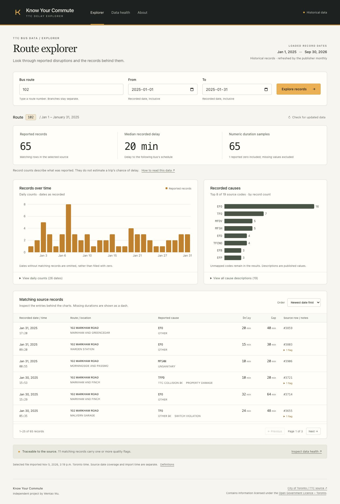
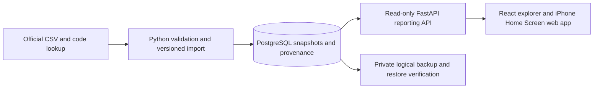

# Know Your Commute — TTC Delay Explorer

An independent project by **Wentao Wu** for exploring historical reported TTC bus delay records. Select a bus route and date range, inspect recorded causes/durations, and follow a result back to its source rows and quality flags.

**Status:** Working locally with **107,349 official records**, a tested PostgreSQL importer, FastAPI API and React/TypeScript dashboard. **68 Python checks and eight desktop/mobile browser checks passed locally.** A real backup was restored and every table fingerprint matched. Website/container and iPhone Home Screen configuration are prepared; hosting is not provisioned. Remote CI status is recorded in [progress](docs/progress.md); a workflow file alone is not a passing run.

Record counts cannot establish a bus trip's delay probability or rank route reliability: this source has no scheduled/operated-trip denominator. Recorded delay minutes describe delay to the following bus's schedule. They are not passenger-minutes lost. This is historical data, not live arrivals.

## Start locally

Use Python 3.13, [uv](https://docs.astral.sh/uv/getting-started/installation/), and PostgreSQL 17. Dependencies are resolved in `uv.lock`. Do not install dependencies into your system Python.

```sh
uv sync --locked
source .venv/bin/activate
export PYTHONPATH="$PWD/src"
set -a
source .env.example
set +a
```

The explicit Python path also handles a macOS development-runner quirk where ignored `.pth` files are marked hidden. It is unnecessary for a normal wheel installation.

With Docker:

```sh
docker compose up -d --wait db
docker compose exec db createdb -U commute commute_test
```

If Docker and PostgreSQL are both absent, an optional project-local build is available. It needs the macOS command line build tools (or equivalent Unix tools), downloads verified PostgreSQL source, and writes only inside ignored `work/`. It installs no system service. In a restricted app runner, execute this in your own Terminal if shared-memory startup is denied:

```sh
python scripts/local_postgres.py setup
```

Then:

```sh
alembic upgrade head
pytest
commute refresh
commute report --route 102 --start 2025-01-01 --end 2025-01-31
commute data-health
```

`refresh` imports the official lookup first, then the current cumulative CSV. It archives the README, metadata and originals with hashes. The terminal output includes the retained manifest path. Import those exact bytes again with:

```sh
commute import-bundle --manifest data/raw/manifest-REPLACE-WITH-ACTUAL-HASH.json
```

This example path is a placeholder, not a created file. Use the path returned by `fetch` or `refresh`. For a download without a database, run `commute fetch`.

See [the runbook](docs/runbook.md) for failure recovery, archived downloads and the existing local source bundle. Integration tests refuse cleanup unless `TEST_DATABASE_URL` names a database ending in `_test`. CI requires those tests to run; a missing URL cannot silently pass the database gate there.

## Open the app

The current checkout already has a built frontend and a loaded local database. Start the app with:

```sh
.venv/bin/python scripts/run_local.py
```

Open [the local explorer](http://127.0.0.1:8000/). The helper binds only to loopback and serves both the built frontend and API. Stop it with Ctrl+C. The app does not import data on visitor requests.

For a fresh checkout, after the Python/database setup and real import above:

```sh
npm --prefix web ci
npm --prefix web run build
.venv/bin/python scripts/run_local.py
```

For frontend development, run `npm --prefix web run dev` in a second terminal; Vite proxies `/api` to the API on port 8000. Node 22.17.1 was used locally. JavaScript dependencies are locked in `web/package-lock.json`.



## What is implemented

- CSV contract verified against the official 2025-onward CSV, the older README and the independently versioned lookup.
- Attributed 20-record fixture with original source positions, plus the small official lookup. Synthetic test records are labelled separately.
- SQLAlchemy Core tables and a frozen Alembic migration for resources, snapshots, attempts, raw rows, typed rows, rejects and code descriptions.
- Audited imports with per-resource locks, checksums, parser/contract versions, pinned lookup versions and atomic active-snapshot replacement.
- SQL route/date totals, duration sample counts, daily counts, causes and traceable examples. Queries use bound values and one consistent snapshot.
- Typed read-only endpoints for route search, summaries, patterns, bounded record pagination and public data health. Browser requests pin the selected snapshot across charts and pages.
- A responsive charcoal/off-white/amber explorer with URL filters/history, keyboard route submission, source-row flags, chart data tables, explicit empty/partial/failure states and data health/about pages.
- pytest validation/download/API tests and PostgreSQL integration scenarios; GitHub Actions includes frontend build and isolated desktop/mobile browser cases. Remote CI has not run.
- Consistent logical backups, a scratch-database restore verifier, explicit API-only database grants and measured PostgreSQL query plans. A manual/opt-in weekly source-check workflow preserves previous good data on failure.
- Home Screen manifest/icons and iPhone installation guidance. The phone view requires a network connection; no native App Store release is claimed.

## How the pieces fit



The importer writes; the public API only reads. A corrected cumulative file replaces
the active snapshot atomically while older versions and identical-looking source
rows remain available. The browser pins a snapshot across its summary, charts and
record pages so a refresh cannot mix versions in one view.

## Read the evidence and decisions

| Document | Purpose |
| --- | --- |
| [Progress](docs/progress.md) | What has actually run, what remains blocked, next step |
| [Data contract](docs/data-contract.md) | Exact observed columns, definitions, validation and ambiguities |
| [Source manifest](docs/source-manifest.json) / [profile](docs/source-profile.json) | URLs, hashes, retrieval/source timestamps and measured quality |
| [Decisions](docs/decisions.md) | Why snapshots, PostgreSQL, row positions and a pinned lookup |
| [Metrics](docs/metrics.md) | Report meanings, zero/missing handling and limitations |
| [Runbook](docs/runbook.md) | Setup, commands, recovery and reproduction |
| [Operations](docs/operations.md) | Manual/weekly source checks, verified restore drill and measured query plans |
| [Website/iPhone release](docs/deployment.md) | Container, credential boundaries, current host limits and release steps |
| [Original project plan](docs/project-plan.md) | Chosen scope and later phases |

## Attribution

Data: [City of Toronto / TTC Bus Delay Data](https://open.toronto.ca/dataset/ttc-bus-delay-data/).

Contains information licensed under the [Open Government Licence – Toronto](https://open.toronto.ca/open-data-licence/).

This project is independent of the TTC and City of Toronto. No official endorsement is implied. Data retains its publisher's licence; no ownership of source data is claimed.
