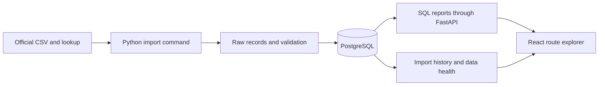

# Know Your Commute — TTC Delay Explorer

Project plan and new-chat handoff for Wentao Wu. Prepared 5 November 2026.

Status: project selected; implementation has not started. This document contains proposed designs, not claims about a finished system. The next chat should begin building the first working slice rather than repeat project selection.

## 1. What we are building

A public web app for exploring historical TTC bus delay records. A visitor selects a route and date range, then examines when disruptions were reported, their recorded causes and their recorded durations. A separate data-health view explains where the records came from and whether imports succeeded.

The portfolio value is the complete workflow: download real public data, preserve its provenance, clean it carefully, load PostgreSQL, answer questions with SQL, expose a tested API and make the result useful through a well-designed interface.

The app should answer three questions well:

1. For this route and period, when were delay records most common?
2. What causes and recorded durations appear in those records?
3. How current, complete and trustworthy is the data behind this view?

Historical incident records alone do not establish the probability that a particular bus trip will be late. They also do not provide live arrivals. The first release is an explorer of reported disruptions, with clear definitions.

## 2. Wentao's goals and constraints

| Item | Context to preserve |
|---|---|
| Name | Wentao Wu; use Wentao in new content |
| Education | U of T Scarborough, Computer Science Specialist co-op, Information Systems stream; expected graduation April 2030 |
| Applications | Winter 2027 and Summer 2027; four- or eight-month work terms |
| Location | Toronto through the end of summer 2027; relocation is a later possibility |
| Career direction | Technical data analytics, automation and data engineering; test automation is another relevant route |
| Starting strengths | Résumé lists Python, C, SQL/SQLite, Pandas, NumPy, Git/GitHub, pytest, Excel and some ML tools; verify practical familiarity rather than assuming mastery |
| Working style | AI-assisted coding is welcome; Wentao needs to understand and explain the important decisions |
| Visual preference | Human, thoughtful and technically interesting; dark charcoal/warm amber is compatible with the portfolio; avoid mint green and sales copy |
| Excluded content | Do not restore Big Way Hotpot, Shift Optimizer or ReddSafe to the portfolio |

Career reasoning and posting examples are saved in:

`/Users/davidwu/Documents/Codex/2026-11-04/i-want-to-build-my-own/outputs/toronto-coop-research-2026-11-05.md`

Those postings are a dated research snapshot and must be rechecked before applying. The file's original Bike Share recommendation is superseded by this TTC project. There is no evidence that a project guarantees an offer or that this field has few applicants. Keep applying while building.

## 3. Scope of version 1

### Required

- TTC **bus** data only, initially the publisher's resource covering 2025 onward.
- Route search and a date-range filter, with optional weekday/time filters once the time semantics are verified.
- Reported-record count, recorded-duration summary with a valid-value sample count, a trend chart and cause breakdown.
- A weekday/hour heatmap if verified timestamps support it.
- A paginated table of matching records so charts can be checked against examples.
- Coverage, source attribution, metric definitions and a visible data-as-of indicator.
- Data-health page showing the latest attempt and latest successful import separately.
- Repeatable imports, safe handling of revised files, useful automated tests and CI.
- A documented local setup, then one public deployment with a working link.

### Later, only after the first version works

- Compare two routes using the same period and clearly labelled raw counts.
- Import one older XLSX year to demonstrate a second source adapter.
- Add streetcar/subway data through explicit adapters after inspecting their different schemas.
- Add a map only when locations can be matched reliably to actual coordinates.
- Consider schedule-normalized measures or forecasting as a separate evaluated extension.

### Outside the first release

Live arrivals, route planning, an AI chatbot, user accounts, forums, listings, push notifications, weather joins, predictive models and a reliability leaderboard. Kafka, Kubernetes and Spark are unnecessary for the initial workload. A complete, explainable application is the priority.

## 4. Official data and what must be verified

Use the [City of Toronto TTC Bus Delay dataset](https://open.toronto.ca/dataset/ttc-bus-delay-data/). The live portal observed on 5 November 2026 listed monthly refreshes, a last refresh of 26 October 2026, yearly XLSX resources for 2014–2024 and a CSV resource covering 2025 onward. These are observations, not permanent constants. The exact source schema and README contents still need inspection.

Source bookmarks observed in the portal:

- [Publisher README XLSX](https://ckan0.cf.opendata.inter.prod-toronto.ca/dataset/e271cdae-8788-4980-96ce-6a5c95bc6618/resource/71bb1283-7388-4d23-aa4e-0f393a80abce/download/ttc-bus-delay-data-readme.xlsx)
- [Bus delay CSV since 2025](https://ckan0.cf.opendata.inter.prod-toronto.ca/dataset/e271cdae-8788-4980-96ce-6a5c95bc6618/resource/b5725365-9252-4bfe-b6f4-cda7ddf74341/download/TTC%20Bus%20Delay%20Data%20since%202025.csv)
- [Code Descriptions CSV](https://ckan0.cf.opendata.inter.prod-toronto.ca/dataset/e271cdae-8788-4980-96ce-6a5c95bc6618/resource/874ae66c-9f6f-443f-91e0-1d37d416e0d8/download/Code%20Descriptions.csv)
- [2024 XLSX for the later adapter](https://ckan0.cf.opendata.inter.prod-toronto.ca/dataset/e271cdae-8788-4980-96ce-6a5c95bc6618/resource/7823b829-9952-4e4c-ac8f-0fe2ef53901c/download/ttc-bus-delay-data-2024.xlsx)

If a direct resource URL changes, find its replacement from the official dataset page and update the source registry. The portal is rendered with JavaScript; an empty text-only fetch is not evidence that the data is unavailable.

Before designing final database columns, inspect the README, code lookup and real rows. Record exact column names, encoding, date/time formats, row meaning, missing-value conventions, duration units and whether stable incident identifiers exist. Investigate whether time is local wall time and how overnight service is represented. Do not invent meanings for fields such as delay versus service gap.

Use the publisher's required attribution, or the licence's fallback statement where applicable, and link to the [Open Government Licence — Toronto](https://open.toronto.ca/open-data-licence/). Keep the app visibly independent from the TTC/City. The licence requires source acknowledgement and does not imply official endorsement.

## 5. Definitions that keep the analysis honest

| Topic | Rule |
|---|---|
| Counting | Call the unit “reported delay records” until the publisher confirms whether each row is a unique incident. Do not imply every service disruption is recorded. |
| Route comparisons | More records may reflect more service. Without scheduled/operated-trip exposure, do not call counts an on-time rate, delay probability or proof that one route is less reliable. |
| Durations | Missing is not zero. Show the count of valid duration observations used. Do not add recorded durations and call the total passenger-minutes lost. |
| Categories | Preserve original codes/text. Unknown codes remain visible as unmapped; do not silently drop their records. |
| Route identifiers | Keep text identifiers and originals. Do not force everything to integers or invent current route names for historical records. |
| Dates and time | Confirm publisher semantics. Keep source service date/time distinct from UTC import timestamps. Do not blindly convert ambiguous local times. |
| Missing periods | An absent period may mean unavailable records. Do not convert it to zero without establishing coverage. |
| Empty results | State that no matching records exist in the loaded data; do not say the route never has delays. |
| Freshness | Display source coverage, source refresh metadata and successful import time separately. A recent import can still contain old data. |

Every chart must use the same active source versions and filter definitions. The API should return coverage and valid-value counts with its statistics.

## 6. Recommended stack and architecture

Use one coherent stack. Resolve installed versions at setup, choose mutually compatible maintained versions and commit dependency lockfiles.

| Layer | Choice | Purpose |
|---|---|---|
| Import/validation | Python; Pandas where helpful; openpyxl for the later XLSX adapter | Build on existing skills; inspect types instead of trusting inference |
| Database | PostgreSQL; Docker Compose for local development | Learn relational modelling, transactions, indexes and real SQL |
| Database access | SQLAlchemy Core and Alembic migrations; PostgreSQL driver | Parameterized queries and explicit migrations; keep reporting SQL readable |
| API | FastAPI with typed request/response models | Reusable filtering and reporting endpoints |
| Interface | React + TypeScript + Vite; one chart library | A polished, responsive explorer without adding another backend |
| Verification | pytest, PostgreSQL integration tests, one browser smoke flow | Protect transformations, imports, filters and the actual user journey |
| Automation | GitHub Actions | Checks on code changes; manual and scheduled imports later |
| Deployment | One container serving FastAPI and the built frontend; external PostgreSQL | One web origin, persistent data separate from the web process |



Imports run as a separate command, never inside a visitor's page request. Start with synchronous, straightforward Python; concurrency is not an achievement by itself. Build the frontend after one real import and one correct SQL report work.

For development, run PostgreSQL in Compose and the API/frontend locally. If Docker is missing, inspect an existing local PostgreSQL installation before choosing another setup. Do not quietly replace PostgreSQL with a JSON-only demo and call the database layer complete.

Official implementation references: [FastAPI tutorial](https://fastapi.tiangolo.com/tutorial/), [SQLAlchemy documentation](https://docs.sqlalchemy.org/), [Vite guide](https://vite.dev/guide/) and [pytest guide](https://docs.pytest.org/en/stable/getting-started.html). Use their current documentation when selecting exact versions.

## 7. Source control and project layout

Create a separate local project at:

`/Users/davidwu/Documents/Codex/know-your-commute`

That path is planned and has not been created by this handoff. Check parent guidance and repository boundaries before initializing Git. The current planning workspace was checked and is not itself a Git repository. Do not reuse the portfolio's repository or hosting identity for this app.

Proposed layout:

```text
know-your-commute/
  README.md
  pyproject.toml                 # Python dependencies and tool settings
  compose.yaml                  # local PostgreSQL
  Dockerfile                    # frontend build + Python runtime
  .env.example                  # names/examples only, no secrets
  src/commute/
    ingest/                     # source registry, adapters, validation, CLI
    db/                         # connection setup and reporting queries
    api/                        # routes and response models
  migrations/
  web/                          # React app and JavaScript lockfile
  tests/
    fixtures/                   # small attributed sample; synthetic edge cases labelled
    unit/
    integration/
  docs/
    project-plan.md
    data-contract.md
    decisions.md
    metrics.md
    runbook.md
    progress.md
  data/                         # downloaded files, ignored by Git
  .github/workflows/
```

Copy this plan into `docs/project-plan.md` when the project starts. Keep raw downloads, `.env`, database dumps and credentials out of Git. Commit a small reproducible fixture and source manifest instead of the entire dataset.

After each milestone, update `docs/progress.md` with what works, commands/checks run, open issues and the next task. This makes future chat handoffs short and reliable. Commit locally when useful; uploading a repo or publishing the app is a later concrete step, not a prerequisite for local work.

## 8. Proposed data model and import rules

These are internal logical entities. Exact fields and constraints depend on the verified source contract.

| Entity | Responsibility |
|---|---|
| `source_resources` | Logical resource, URL, source coverage/partition and active snapshot pointer |
| `source_snapshots` | Resource, content hash, fetched time, schema signature and version of parser/contract |
| `import_runs` | Every attempt, status, timing, counts, error summary and associated snapshot |
| `raw_records` | Original payload, snapshot and source row position for traceability |
| `delay_records` | Typed analytical fields plus raw-record reference and quality flags |
| `incident_codes` | Versioned official descriptions, if compatible with the actual source |
| `rejected_records` | Unusable rows with reasons; warnings for usable rows remain separately countable |

Key import behaviour:

1. Download with a timeout, bounded retries and status/content checks. Detect an HTML error page disguised as a successful download.
2. Hash the bytes and validate expected headers/types. Unknown extra columns are preserved and reported; missing required columns block promotion.
3. Record each attempt. For identical bytes with the same parser/contract version and a successful prior import, record a no-change result rather than insert more records. A new parser version may deliberately reprocess identical bytes.
4. Preserve raw values. Normalize documented fields, retain warnings and quarantine only records that cannot meet the minimum contract. Decide that minimum after inspecting the publisher README.
5. Reconcile raw row totals with accepted and rejected records. Document exclusions such as blank lines explicitly.
6. Build the new snapshot separately, validate it, then atomically change the active pointer. A failed refresh must leave the previous good snapshot available.
7. Treat a revised cumulative CSV as a replacement snapshot for that resource, not an append-only stream. This avoids counting corrections and old copies twice.
8. Serialize competing imports for a resource with a database lock or equivalent guard. Make rollback/retry behaviour testable.

Do not invent a unique incident key. A source snapshot plus row position identifies an ingested row; it does not prove business-level uniqueness. Identical-looking rows might be legitimate. Flag suspected duplicates for analysis before choosing a deduplication rule. Reports must read only the selected active snapshots. Do not join overlapping historical sources without a documented precedence rule.

The code lookup may change independently from the main CSV. Record which lookup version was used. Never turn an unrecognized category into missing data silently.

## 9. API and SQL reports

Proposed read-only API under `/api/v1`:

| Endpoint | Behaviour |
|---|---|
| `/routes` | Available route identifiers and loaded coverage; no invented route-name mapping |
| `/summary` | Count, valid-duration summary and applied filters |
| `/patterns` | Time buckets, cause breakdown and optional weekday/hour matrix |
| `/records` | Bounded, paginated examples with stable ordering |
| `/data-health` | Latest attempt, last success, source coverage and quality summary |
| `/health` | Process health; distinguish database readiness if a separate readiness endpoint is needed |

Use one filter model across endpoints. Validate dates/ranges, parameterize database values and allowlist sort fields. Bound page sizes and return readable validation errors. Keep raw diagnostic payloads and import commands out of the public API.

Write SQL for count by route/date, cause distribution, weekday/hour patterns and recorded-duration statistics with a valid-observation count. Start with suitable route/date indexes and inspect actual query plans before adding more. Avoid caching until measurements show a need. Test summaries against a hand-calculated fixture and direct database queries.

An API request spanning several queries must use one consistent snapshot selection, so a refresh cannot produce mismatched totals and charts.

## 10. Interface and design direction

Use a compact transit-analysis workspace: clear typography, restrained colour, useful charts and enough spacing. Avoid a large marketing hero or claims such as “revolutionizing your commute.”

```text
Know Your Commute                 Explorer | Data health | About
Historical TTC bus delay records           Coverage / last update

Route [search/select]    Dates [start — end]    Weekday/time [optional]

Reported records       Median recorded delay       Valid duration samples

Records over time                    Recorded causes
Weekday/hour patterns                Matching source records

Definitions · Source · Licence · Independent project by Wentao Wu
```

Use charcoal, off-white and a warm amber accent; offer accessible contrast and chart labels that do not depend on colour. Start with one well-finished theme. Include loading, empty, failure and partial-data states. Preserve filters in the URL for sharing; make browser back/forward work.

On phones, filters and charts stack cleanly; the record table can scroll within its own area. Test route search with a keyboard. A text/table summary should communicate the chart's main values. Any small motion must respect reduced-motion settings. A map is not required to make this look good.

## 11. Build sequence and acceptance checks

Treat these as gates, not a promise of a fixed number of days. Several focused sessions may be needed. Keep the first dataset modest and finish each working slice before adding features.

### Phase 0 — Verify the data and prepare the project

Inspect available Python, Node, Docker/PostgreSQL and local guidance. Create the isolated project. Fetch the official README, lookup and current CSV; record hashes and retrieval times. Profile the actual columns and values. Write the data contract, source manifest, a small attributed fixture and an initial decision log.

**Done when:** the real source can be opened, its exact schema/units and known ambiguities are recorded, the fixture is reproducible and the local database setup path is clear. Report unresolved data semantics explicitly rather than invent answers.

**Wentao should understand:** what a source row means; the difference between a record count and a trip-level delay probability.

### Phase 1 — One reliable import and one useful SQL report

Create migrations, source/snapshot/run tables and the CSV adapter. Load a real source into PostgreSQL, produce a route/date report and record validation results. Add the no-change path, failed-import recovery and active-snapshot promotion.

**Done when:** importing the same source twice leaves analytical counts unchanged; a modified fixture replaces its prior active snapshot correctly; a failed import preserves the good data; counts reconcile; key edge-case tests pass against PostgreSQL.

**Wentao should understand:** transactions, safe reruns, snapshot replacement, provenance and why a fingerprint is not necessarily an incident ID.

### Phase 2 — A tested reporting API

Implement route listing, filters, summaries, patterns, pagination and data health. Add typed responses and tests using a small known database fixture.

**Done when:** route/date filters return the expected records and totals; invalid requests fail clearly; empty results behave correctly; public responses do not expose credentials or raw failure traces.

**Wentao should understand:** parameterized SQL, indexes, API contracts and how a test catches a plausible reporting bug.

### Phase 3 — A polished browser demo

Build the React interface on the real API. Add URL filters, charts, source records, data health, definitions and attribution. Verify desktop, mobile, keyboard access and the loading/empty/error states.

**Done when:** a visitor can select a route, change dates, inspect a pattern, check matching rows and see where the data came from. A fresh page load and browser back/forward retain the intended filter state. No hardcoded success statistics stand in for the API.

**Wentao should understand:** how a filter travels from the page through the API to SQL and returns as a chart.

### Phase 4 — Automation, recovery and measurement

Add CI checks for Python, the PostgreSQL integration tests, TypeScript/build and one key browser journey. Add a manual refresh workflow, then a weekly source check suited to monthly publication. Protect production imports from overlap and record failures without deleting usable data.

Measure actual dataset size, accepted/rejected counts, import time, query latency and database size. Record conditions and warm/cold results. Demonstrate rollback/retry and at least one restored database or reproducible rebuild. Check one query plan and document any change justified by it.

**Done when:** a deliberate bad input is detected, CI catches a meaningful regression and a failed refresh leaves the app usable. Metrics are measured and reproducible rather than guessed.

**Wentao should understand:** what is automated, what can fail, where to find the evidence and how to recover.

### Phase 5 — Publish and package for applications

Build the deployment container, select the host after checking current limits and account access, provision persistent PostgreSQL and run migrations/imports with the appropriate credentials. Verify the deployed app and link it from the portfolio after it works.

Finish the README, architecture diagram, screenshots, a short demo recording, a data-limitations note and a small case study with findings supported by the data. Record the actual public URL and repository URL only after they exist.

**Done when:** someone else can open the public app, follow the documented local setup, understand the core decisions and reproduce the important reports. Update the portfolio with honest implementation status and measured results.

**Wentao should understand:** the deployed components, credential boundaries, known limitations and one concrete improvement made after testing.

## 12. Meaningful tests

Prefer tests that detect wrong results or unsafe imports. Do not add cosmetic tests or tests that merely repeat implementation details.

| Scenario | Expected evidence |
|---|---|
| Hand-checked fixture | Counts, duration sample sizes and buckets match manually calculated results |
| Missing duration versus zero | Missing observations do not become zero-duration observations |
| Unknown route/category values | Original values survive and the documented unknown/unmapped behaviour is applied |
| Bad date/type, changed headers or HTML download | A useful failure/rejection is recorded; good data stays active |
| Repeated download | No duplicate analytical records are introduced |
| Corrected cumulative CSV | Active reports reflect the replacement rather than both versions |
| Identical-looking source rows | Legitimate rows are not automatically deleted without a documented key |
| Interrupted or overlapping imports | No partial snapshot is promoted and the retry is safe |
| Boundaries | Inclusive/exclusive dates, hour filters and source time semantics match the contract |
| API filtering and pagination | Totals and matching rows agree; ordering is stable; invalid sort/filter values are handled safely |
| Browser smoke journey | Select route → change dates → inspect records/data health works against the API |

Use the same database engine in integration tests as in the app. Use small local fixtures in CI; do not make every test depend on a live City download. Separately exercise one real-source import so a passing synthetic fixture does not conceal a broken adapter.

## 13. Deployment and refresh plan

Recommended deployment candidate: a Render web service running the container, with PostgreSQL on Neon. The container builds the React assets and FastAPI serves them alongside `/api`; keep SPA fallback handling from swallowing API errors. This is a proposed deployment, not an existing account setup or a promise of indefinite free hosting.

[Render documents FastAPI deployment](https://render.com/docs/deploy-fastapi), and [Neon documents PostgreSQL connections and TLS](https://neon.com/docs/connect/connect-from-any-app). Before provisioning, recheck both providers' current quotas, costs, regions and account requirements. Prefer the same supported PostgreSQL major locally and in the chosen host.

Important operating details:

- Render's current free web-service documentation describes idle spin-down and an ephemeral filesystem. Keep the authoritative database external and expect a cold start if using that tier. Its free PostgreSQL database currently expires after 30 days, so do not use that as the long-lived portfolio database. [Render free-instance limits](https://render.com/docs/free).
- Use a read-only database role for the public API and a separate import/migration role. Configure credentials through environment secrets; never place them in frontend variables, logs or Git.
- The importer can run in GitHub Actions using a production import credential. Start with manual runs. A weekly check can skip unchanged content and avoid pretending that monthly source data is live.
- GitHub schedules can be delayed or dropped, and public-repository schedules can disable after inactivity. Keep a manual trigger, display actual freshness and document recovery. [GitHub workflow triggers](https://docs.github.com/en/actions/reference/workflows-and-actions/events-that-trigger-workflows#schedule).
- Retain provenance/raw payloads and a documented backup/rebuild path. An app container's local files are not durable storage. Preserve downloaded originals locally during development; choose additional object storage only if a real retention need justifies it.
- Apply migrations deliberately, verify readiness, then import. Take a recovery snapshot/dump before risky changes and test the restoration or rebuild procedure.

Do not buy hosting, a domain or other paid services as part of the first coding session. Prepare a working local result and deployment configuration before account/cost decisions. The project does not depend on the pending student-domain offer.

The existing portfolio's Sites hosting is a separate deployment. A Python/FastAPI/PostgreSQL service needs a compatible backend host; do not assume the portfolio's current static Sites configuration can run it.

## 14. Evidence for the résumé and interview

Collect real results as the work progresses:

- Source records/period loaded; valid, rejected and flagged counts with definitions.
- Import runtime and rerun result under documented conditions.
- Query measurements and a query-plan-driven improvement, if one is justified.
- A failure example caught by a test and a refresh/recovery demonstration.
- Two or three defensible findings, each tied to a query, period and caveat.
- Feedback from anyone who actually tries the demo; claim users only when there are real users.

Potential résumé structure after completion: “Built a Python/PostgreSQL pipeline and interactive TTC delay explorer; implemented versioned imports, validation and a tested reporting API.” Add scale, speed or quality figures only once measured. Do not write invented impact or claim the project is deployed before it is.

Prepare concise interview explanations for: why TTC data, why PostgreSQL, handling a corrected source, retaining unknown values, avoiding a misleading reliability score, one SQL decision, one test that matters, one failure/recovery and what you personally learned while using AI tools.

Use AI for scaffolding, routine code, debugging and UI iteration. At each milestone, Wentao should trace one real record end to end, change one rule or query himself and explain the resulting test. Keep design decisions understandable; do not add tools only to lengthen the skills list.

## 15. Existing portfolio and continuity

The current portfolio source is:

`/Users/davidwu/Documents/Codex/2026-11-04/i-want-to-build-my-own/outputs/personal-website`

Current public link recorded in this conversation:

https://personal-readme-h7q2m.sappyrabbit.chatgpt.site/

Preserve its name, professional headshot, selected personal content, research paper and current design. The portfolio currently features the earlier planned Know Your Vehicle idea. Do not rewrite or redeploy the portfolio during Phase 0–1. Once this TTC app works, update its project section to reflect the real project and real links. Recheck the live state before editing.

GitHub: https://github.com/d-wt-wu

LinkedIn: https://www.linkedin.com/in/david-wentao-wu/

Custom-domain work is separate and unfinished. No domain purchase is confirmed. Student benefits were approved on 4 November 2026 with a stated 72-hour activation delay; recheck offers/availability when needed. Local project work can start immediately.

## 16. The first task in the new chat

Read this plan and the dated career notes. Inspect local instructions, tools and the proposed project path. Start Phase 0, then continue into Phase 1 if the source semantics and environment allow it. Produce a real fixture, source contract, database migration, import command and first SQL report. Run the relevant tests. Explain what works and the next unresolved step; do not stop after generating another plan or a decorative dashboard.

If a download, database setup or permission requirement blocks one part, state the exact blocker and continue independent local work. Ask Wentao only for genuinely missing information or necessary account/cost decisions. Do not request approval again for reversible implementation already covered by the instruction to build the project.

This plan can adapt to verified data facts or practical setup constraints. Record the reason for a substantive change, keep the chosen scope and finish a working slice before expanding.
