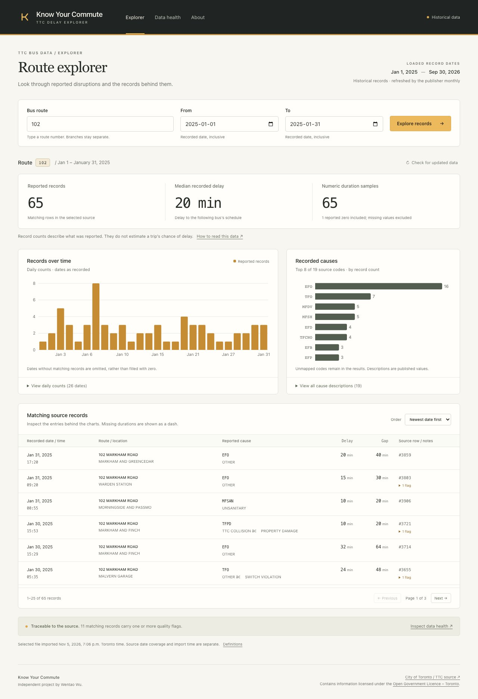

# Verified website release

Owner: Wentao Wu. Released **5 November 2026** (Toronto).

**[Open Know Your Commute](https://know-your-commute.onrender.com)**

The HTTPS website serves the React app and FastAPI API from one Render Free
Docker service in Virginia. It reads the existing Neon PostgreSQL 18.6 database.
The service was created from the public repository URL, so no new GitHub App
repository permissions were needed. No card, domain or paid service was added.

## What changed

- Created Render service `srv-dbmik7jrjlhs73cm99dg` from `main`, root Dockerfile,
  Free instance, Virginia, manual releases, health path `/api/v1/health`.
- With the owner's explicit approval, saved the existing dedicated API-role
  connection as Render's `DATABASE_URL`, with `COMMUTE_REQUIRE_READONLY=1`.
  Render received no owner/import connection. The role has SELECT on the five
  reporting tables; record writes, raw/rejected reads and schema creation remain
  outside its grants. The existing private local environment was preserved.
- Deployed source commit `e479d2dc156daf25fac041cb153bce07af2a8e92`. Its application
  implementation is the tested `3c43bc2`; the intervening commit contains docs.
  The first Render deployment `dep-dbmik83rjlhs73cm9af0` succeeded.
- Added `web/playwright.hosted.config.ts` and `npm --prefix web run test:hosted`.
  It reuses the real-source desktop/mobile journeys without starting a server
  or writing/seeding production data. It requires a plain HTTPS origin and
  refuses credentials, query strings and paths in that address.
- Added locked Node 22 type declarations for the Node-based test configuration.
  Expanded `scripts/check_deployment.py` to verify readiness, direct page links,
  chart totals, snapshot consistency, record pagination and source health.
- Updated README, deployment guide, Neon setup and progress with the actual URL,
  verified results and current remaining work. Saved public screenshots and
  credential-free evidence. The existing portfolio/paper/photos were preserved.

Changing `render.yaml` alone does not update this manually created service.
Future releases need the normal checks and a deliberate Render manual deploy.
There is no automatic import/migration on app startup or visitor requests.

## Observed command output

Root `npm run build` exited **0** after Neon config and frontend type checks:

```text
vite v8.3.6 building client environment for production...
✓ 401 modules transformed.
✓ built in 103ms
```

The time is the Vite stage, not an end-to-end performance benchmark.
Render independently built the container and reported:

```text
INFO: Application startup complete.
INFO: Uvicorn running on http://0.0.0.0:10000
GET /api/v1/health HTTP/1.1 200 OK
==> Your service is live
==> Available at your primary URL https://know-your-commute.onrender.com
```

Public HTTP check:

```sh
python scripts/check_deployment.py --base-url https://know-your-commute.onrender.com --expected-records 65
```

```json
{"status":"verified","route_102_january_records":65,"median_recorded_delay_minutes":20.0,"accepted_source_records":107349,"rejected_source_records":0,"readiness":"ready","pattern_totals":"reconciled","home_screen_assets":"served","missing_api_and_assets":"JSON 404"}
```

Public browser check (the browser is already installed in this Mac's project):

```sh
PLAYWRIGHT_BROWSERS_PATH="$PWD/work/pw-browsers" COMMUTE_PUBLIC_BASE_URL=https://know-your-commute.onrender.com npm --prefix web run test:hosted
```

```text
✓ [desktop] real Neon records flow through API, filters, pages and source health (3.9s)
✓ [mobile] real Neon records flow through API, filters, pages and source health (3.4s)
2 passed (8.3s)
```

Each journey verified 65 January route-102 records / median 20 minutes / n=65,
39 records through January 15, chart reconciliation, page 2, reload/back history,
source health (107,349 accepted / zero rejected), About/install guidance,
contained layout and no JavaScript page errors. The HTTP checker additionally
verified independent direct links, readiness, daily/cause/weekday totals and
nonoverlapping record pages on the same active snapshot.

The prior [implementation CI](https://github.com/d-wt-wu/know-your-commute/actions/runs/42140733466)
passed PostgreSQL 17/18: 73 Python cases, eight isolated synthetic browser cases,
root build, container build and startup per job. Its fixture's route-102 total is
35; it is deliberately separate from the real source's 65. Public HTTP/browser
results are in `evidence/public-website.json`.

Follow-up [release-check CI](https://github.com/d-wt-wu/know-your-commute/actions/runs/42143684661)
also passed on `e120707`: both PostgreSQL 17/18 jobs ran 73 Python cases and eight
synthetic browser cases, built the container and passed the expanded HTTP smoke
check against its 40-row synthetic source / 35 matching January records. Both
Python jobs reported the existing single Starlette/httpx deprecation warning.
The live service remains the verified `e479d2d` application; verification/docs/type
declarations do not require another deployment. All four published JS/CSS assets
matched the local build byte for byte, with zero private credential matches.

## Failures, limits and next work

The first public-browser invocation failed before any page ran because it looked
in the default Playwright cache. Pointing to the already installed project browser
resolved it; both cases then passed with retries disabled. An extra standalone
config typecheck initially lacked Node declarations/type-root selection; adding
the locked types and explicit path resolved it. The first dependency download
needed network access. The final build and config check passed. Render itself
built and started on its first deployment. Its initial `HEAD /` probe returned
405; the configured GET health check and normal page requests returned 200.

- Render Free sleeps after 15 idle minutes; waking can take about a minute.
  Do not add a card or upgrade silently. [Current Render Free limits](https://render.com/docs/free).
- On an iPhone, open the website in Safari, use Share → Add to Home Screen,
  and Open as Web App if offered. The app needs internet. Actual installation
  on a physical iPhone has not been observed. [Apple's guide](https://support.apple.com/en-lamr/guide/iphone/iphea86e5236/ios).
- A native iOS/App Store app, offline dataset, real-time arrivals, scheduled
  production imports and real user counts are not claimed.
- A hosted PostgreSQL 18 backup/restore drill still needs matching client tools.
  The existing verified local drill is on PostgreSQL 17. Source refresh remains
  opt-in until storage/backup checks and the production refresh secret are set.
- Neon skills and project OAuth MCP configuration are installed and preserved;
  a live authenticated Neon MCP call remains unverified in this chat. The app's
  independent Neon database connection is verified.
- Finish a short case study and demo using these observed results. Historical
  reported incident counts still cannot establish trip-level delay probability
  or route reliability rankings.


